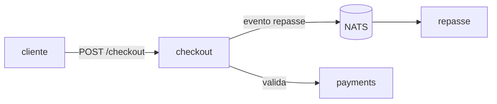

# Índice/MAPA, archive e diagramas — o rastro que a auditoria e o overdev consomem

> A doc mais valiosa da casa não é a prosa: é o **índice/MAPA (§39)** — o mapa exaustivo do que
> existe, onde mora e como se faz cada coisa — e o **archive (§28)** — o rastro versionado de toda
> decisão, plano, handoff e relatório. É esse rastro que a `schematize-audit` **lê** pra cobrar
> promessas e que o **overdev** consome pra saber onde parou. Doc sem índice é biblioteca sem
> catálogo; índice que apodrece é pior que não ter. Este reference é a doc estrutural: índice,
> archive e diagramas versionados.

## 1. O índice/MAPA (§39) — fonte da verdade, conta e não resume

O código diz **como** está agora; o índice diz **o que existe, onde mora e como se faz cada
coisa** — e é tratado como **fonte da verdade** do projeto: consultado antes de criar algo (pra não
duplicar) e atualizado a cada mudança. Dois níveis, versionados em `<projeto>_archive/index/`:

- **Índice global (`INDEX_GLOBAL.md`)** — o mapa macro: repos/serviços/bounded contexts e como se
  comunicam; as pastas top-level de cada repo e a responsabilidade de cada uma; **o que cada coisa
  faz** e o ponto de entrada de **como se faz** (link pro fluxo/use-case/runbook). O "mapa do
  território". Inclui o **grafo de serviços** (mermaid) com todos os microserviços e seus contratos.
- **Índice de microfunções (`INDEX_FUNCTIONS.md`, por serviço)** — **exaustivo**: uma linha por
  unidade chamável (função, método, handler, hook, job/consumer), pública **e** privada, de **cada**
  serviço. Formato `função | o quê | de onde → pra onde | chama (out) | é chamada por (in) | efeitos
  | arquivo:linha`. Acompanha o **grafo de chamadas** (mermaid + adjacência).

Invariantes que fazem o índice ser confiável em vez de decorativo:

- **Conte, não confie.** Por serviço, `nº de entradas no índice == nº de funções declaradas no
  código`. O `/<slug>-index` e o CI **contam as declarações** (AST/ctags/regex) e **reprovam** se o
  índice tiver menos entradas que funções — listando as que faltam **pelo nome**. Índice com 90
  linhas pra 100+ funções é **falha dura**, não aviso. O mapa **enumera** o sistema, não o resume.
- **Cobertura total.** O índice global lista **cada** serviço/repo (nenhum de fora); cada serviço
  tem o índice de funções **completo**. "Função irrelevante" não é filtro pra pular nada.
- **Gerado por script.** O índice sai dos **doc-comments padronizados** (§6) via `/<slug>-index`; o
  CI compara o commitado com o gerado e a divergência aponta índice **ou** comentário desatualizado.
- **Gate no merge.** Todo PR que adiciona/remove/move funcionalidade atualiza o índice no **mesmo
  PR**. Índice desatualizado **trava o merge** (item da DoD §35).

> O índice responde "isso já existe? onde? como faço X?" **sem reler o código**. Se a resposta
> exige caçar no código, o índice falhou — ou está desatualizado, e isso é bug. É por isso que ele
> é gerável, contável e tem gate: um mapa que mente sobre o território é pior que nenhum mapa.

## 2. O archive (§28) — o rastro durável, root limpo

Todo `.md` gerado pela skill/agente mora em `<projeto>_archive/`, **nunca no root**. O archive **é
versionado** (entra no PR) e é onde vive a memória do projeto:

> **A planta do archive tem UM dono: a `schematize-archive`** (`references/archive.md`, seção
> "Estrutura"). Não repetimos a árvore aqui — três plantas concorrentes foi o achado B2 da vistoria
> de 2026-08-21, e a divergência entre elas quebrou o caminho do ADR. O que interessa a esta skill:
>
> - o índice §39 mora em **`<projeto>_archive/index/`** (`MAPA.md`, `INDEX_GLOBAL.md`,
>   `INDEX_FUNCTIONS.md` + grafos);
> - o **ADR mora em `<projeto>_archive/decisoes/`** — caminho único da casa, o mesmo que o
>   `/docs-adr` grava, a `/archive-todos` lê e a `/audit-run` audita.

- **Root limpo:** só código, config e os MDs de mão — `README`, `CLAUDE`, `LICENSE`, `CHANGELOG`, `CONTRIBUTING`, `SECURITY`. (Runbook mora em `docs/`, não no root.) ADR **não** fica no root: mora em `<projeto>_archive/decisoes/`. Largar MAPA/índice/plano/relatório no root é **violação (§37)**.
- **Archive é parte da entrega, não extra:** PR sem o `.md` que a regra exige **não passa no
  review** (§35). Falta de tempo **não revoga** a §28 — gerar o `.md` é tão obrigatório quanto
  compilar.
- **Regra de bolso:** antes de gravar qualquer `.md`, o caminho começa com `<projeto>_archive/` (ou
  `docs/`). Se ia escrever no root, pare e mova.

## 3. Por que este rastro importa — a auditoria e o overdev o consomem

O índice e o archive não são doc "pra constar"; são **entrada** de outras disciplinas:

- **A `schematize-audit` lê o archive** — enumera e conta os checklists de `overdev/`, `plan/`,
  `qa/`, `context/`, `scan/`, os ADRs `proposed`, as perguntas parkeadas — e prova que cada item
  foi sanado. Archive incompleto = auditoria incompleta. **Documentar bem é o que faz a auditoria
  passar.**
- **O overdev consome o índice e as decisões** — na Fase 0 ele carrega o grafo do índice e as
  decisões acordadas pra derivar o checklist. Índice defasado = overdev planejando sobre um mapa
  errado.
- **A `schematize-engineering` cobra os dois** — DoD (§35), archive (§28) e índice (§39) são gates
  dela; esta skill é a camada de **como** esses artefatos ficam bons e verdadeiros.

> Regra: o índice e o archive são a doc que **outras máquinas leem**. Prosa desleixada um humano
> tolera; um índice cuja contagem não bate ou um archive com buraco quebra a auditoria e o overdev.
> Por isso este é o rastro com o gate mais duro.

## 4. Diagramas — C4/mermaid versionados como código

Diagrama de arquitetura é doc — e doc que apodrece engana. A casa versiona diagrama **como código**,
nunca como PNG/Figma solto que ninguém consegue editar nem revisar no diff:

- **Modelo C4** pros níveis que importam: **Contexto** (o sistema e seus atores/sistemas externos),
  **Contêiner** (os serviços/apps/bancos e como falam), **Componente** (dentro de um serviço, quando
  vale) — Código raramente, o índice §39 já cobre.
- **Mermaid (ou PlantUML) em texto**, embutido no `.md` (README, índice global, ADR). É
  versionado, revisável no PR, diffável e renderiza em qualquer viewer. Um `graph`/`flowchart`/
  `sequenceDiagram` de mermaid mora ao lado do que descreve.

- **Fonte única:** o grafo de serviços/chamadas do índice (§39) já é mermaid — o diagrama de
  arquitetura reaproveita, não desenha um segundo que diverge.
- **Sem PNG órfão:** imagem exportada não é versionada como fonte; se precisar de imagem, ela é
  **gerada** do texto no build. Diagrama que só existe como imagem é diagrama que ninguém atualiza.

## 5. Onde cada coisa mora (resumo)

| Artefato | Onde | Gate |
|---|---|---|
| `INDEX_GLOBAL.md` / `INDEX_FUNCTIONS.md` | `<projeto>_archive/index/` | contagem bate (§39), trava merge |
| Relatórios/planos/handoffs/scans/auditorias | `<projeto>_archive/**` (§28) | PR sem o `.md` exigido não passa |
| Diagramas (C4/mermaid) | texto no `.md` (README/índice/ADR) | versionado como código; gate `diagrama` reprova imagem sem fonte |
| ADR | `<projeto>_archive/decisoes/ADR-NNNN-<slug>.md` | gate `adr` (`proposed` não fica órfão), `adr.md` |
| Runbook / OpenAPI | `docs/runbook*` · `openapi.yaml` (raiz ou `docs/`) | gates `links` e `openapi`/`drift`, `runbooks.md` / `api-versionamento.md` |
| Changelog | raiz (`CHANGELOG.md`) | gate `root` |
